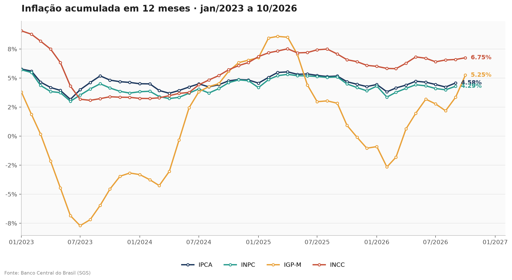

# ETL API BACEN: Inflation Indices

A data extraction and calculation project for inflation indices, using the open APIs of the Central Bank of Brazil (BCB, SGS). The script queries the time series, computes the 12-month cumulative inflation and generates a comparison chart of the four main indices.



## Indices

| Index | SGS code | Description |
|---|---|---|
| IPCA | 433 | Broad Consumer Price Index (official inflation target index) |
| INPC | 188 | National Consumer Price Index |
| IGP-M | 189 | General Market Price Index |
| INCC | 7456 | National Construction Cost Index |

## Method: 12-month cumulative inflation

Cumulative inflation is not the sum of the monthly rates. It is obtained by compounding the monthly indices:

```
cumulative = ((1 + m1) × (1 + m2) × ... × (1 + m12)) − 1
```

The calculation uses the identity `product = exp(sum(log(x)))`, which turns multiplication into a sum of logarithms. In pandas, it looks like this:

```python
factor = 1 + df["valor"] / 100
cumulative = (np.exp(np.log(factor).rolling(12).sum()) - 1) * 100
```

Example: January = 0.50%, February = 0.40% and March = 0.30% give `(1.005 × 1.004 × 1.003) − 1 = 1.2047%`.

The first 11 months of the series do not have a full 12-month window, so the analysis starts in January 2023. The query starts in January 2022 to guarantee that history.

## Project structure

```
├── scripts/
│   ├── consulta_sgs.py         # Queries the IPCA and shows the first records
│   ├── acumulado_12_meses.py   # Computes the 12-month cumulative IPCA
│   └── grafico_indices.py      # Queries the four indices and generates the chart
├── images/
│   └── indices_acum12.png      # Chart generated by the script
├── requirements.txt
└── README.md
```

## How to run

**1. Clone the repository and enter the folder:**

```bash
git clone https://github.com/MatheusEuzebioMalaquias/etl-api-bacen-indices-inflacao.git
cd etl-api-bacen-indices-inflacao
```

**2. Install the dependencies:**

```bash
pip install -r requirements.txt
```

**3. Run the scripts:**

```bash
python scripts/consulta_sgs.py
python scripts/acumulado_12_meses.py
python scripts/grafico_indices.py
```

The last script saves the chart to `images/indices_acum12.png`.

Requires Python 3.10 or higher and internet access.

## About this project

This project is a local reimplementation, in pandas, of a pipeline I built with PySpark and Delta Lake. In the original environment, extraction ran in a RAW notebook, transformation in a TREATED notebook, and the output was loaded into Delta tables consumed by a BI report. Here, the query and calculation logic was kept, using public BCB data, so anyone can run the code.

## Next steps

- Add Boletim Focus expectations (annual IPCA, Selic and exchange rate)
- Add the Selic target rate and the ex-ante real interest rate
- Add data quality tests, such as null counts and duplicates per date and index
- Rewrite the extraction in PySpark with Delta storage, as in the original environment

## Tech stack

Python, pandas, NumPy, Matplotlib and the Central Bank of Brazil SGS API.

## Author

Matheus Euzebio Malaquias