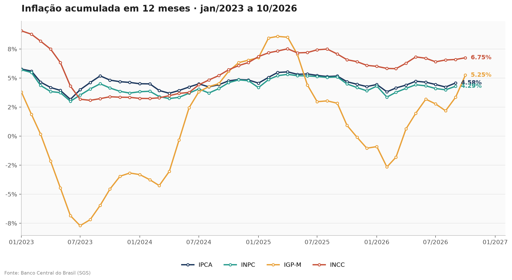

🇧🇷 Português · [🇬🇧 English](README.en.md)

# ETL API BACEN: Índices de Inflação

Projeto de extração e cálculo de índices de inflação a partir das APIs abertas do Banco Central do Brasil (SGS). O script consulta as séries, calcula o acumulado de 12 meses e gera um gráfico comparativo dos quatro principais índices.



## Índices consultados

| Índice | Código SGS | Descrição |
|---|---|---|
| IPCA | 433 | Índice Nacional de Preços ao Consumidor Amplo |
| INPC | 188 | Índice Nacional de Preços ao Consumidor |
| IGP-M | 189 | Índice Geral de Preços do Mercado |
| INCC | 7456 | Índice Nacional de Custo da Construção |

## Método: acumulado de 12 meses

A inflação acumulada não é a soma dos percentuais mensais. Ela é obtida pela composição dos índices:

```
acumulado = ((1 + m1) × (1 + m2) × ... × (1 + m12)) − 1
```

O cálculo é feito com a identidade `produto = exp(soma(log(x)))`, que transforma a multiplicação em soma de logaritmos. No pandas, isso fica assim:

```python
fator = 1 + df["valor"] / 100
acumulado = (np.exp(np.log(fator).rolling(12).sum()) - 1) * 100
```

Exemplo: janeiro = 0,50%, fevereiro = 0,40% e março = 0,30% resultam em `(1,005 × 1,004 × 1,003) − 1 = 1,2047%`.

Os primeiros 11 meses da série não têm janela completa, por isso a análise começa em janeiro de 2023. A consulta parte de janeiro de 2022 para garantir esse histórico.

## Estrutura do projeto

```
├── scripts/
│   ├── consulta_sgs.py         # Consulta o IPCA e mostra os primeiros registros
│   ├── acumulado_12_meses.py   # Calcula o acumulado de 12 meses do IPCA
│   └── grafico_indices.py      # Consulta os quatro índices e gera o gráfico
├── images/
│   └── indices_acum12.png      # Gráfico gerado pelo script
├── requirements.txt
└── README.md
```

## Como executar

**1. Clone o repositório e entre na pasta:**

```bash
git clone https://github.com/MatheusEuzebioMalaquias/etl-api-bacen-indices-inflacao.git
cd etl-api-bacen-indices-inflacao
```

**2. Instale as dependências:**

```bash
pip install -r requirements.txt
```

**3. Rode os scripts:**

```bash
python scripts/consulta_sgs.py
python scripts/acumulado_12_meses.py
python scripts/grafico_indices.py
```

O último script salva o gráfico em `images/indices_acum12.png`. Como a pasta `images` precisa existir antes da execução, ela já está no repositório.

Requer Python 3.10 ou superior e acesso à internet.

## Sobre este projeto

Este projeto é uma reimplementação local, em pandas, de um pipeline que construí em PySpark com Delta Lake. No ambiente original, a extração ficava em um caderno RAW, a transformação em um caderno TREATED e a carga em tabelas Delta consumidas por um relatório de BI. Aqui, a lógica de consulta e de cálculo foi mantida, com dados públicos do BCB, para que o código possa ser executado por qualquer pessoa.

## Próximos passos

- Incluir as expectativas do Boletim Focus (IPCA anual, Selic e câmbio)
- Incluir a Selic meta e a taxa de juros real ex-ante
- Adicionar testes de qualidade, como contagem de nulos e duplicatas por data e indicador
- Reescrever a consulta em PySpark, com gravação em Delta, como no ambiente original

## Tecnologias

Python, pandas, NumPy, Matplotlib e API SGS do Banco Central do Brasil.

## Autor

Matheus Euzebio Malaquias